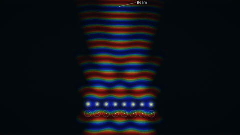
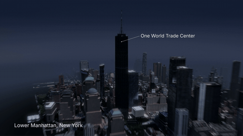
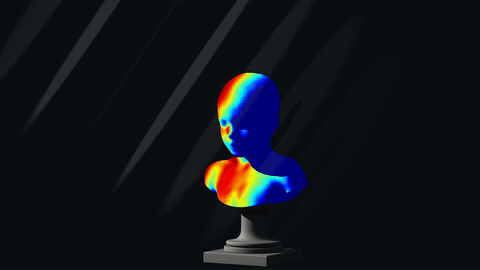
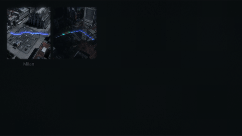

# Films from my PhD defense talk

This repository has the 4K versions of the films I showed in my PhD defense talk on radio waves and the human body.

## Films

All films are 3840 x 2160, 30 fps, H.264 and silent.

| Film | Length | Shows |
|---|---|---|
| [Card](https://github.com/rwydaegh/phd-talk-films/releases/download/v1/card_4k.mp4) | 0:24 | The invitation card as a seamless loop |
| [Film 1](https://github.com/rwydaegh/phd-talk-films/releases/download/v1/film01_plane_wave_4k.mp4) | 2:01 | What a radio wave is and how the body absorbs it |
| [Film 7](https://github.com/rwydaegh/phd-talk-films/releases/download/v1/film07_phantoms_4k.mp4) | 0:41 | Four computer models of the human body, cut open to show their tissues |
| [Film 10](https://github.com/rwydaegh/phd-talk-films/releases/download/v1/film10_factory_4k.mp4) | 1:23 | Antennas in a factory hall send rays to a worker on a phone call |
| [Film 14](https://github.com/rwydaegh/phd-talk-films/releases/download/v1/film14_new_york_4k.mp4) | 0:48 | A pedestrian in New York and the field around her ear |
| [Film 16](https://github.com/rwydaegh/phd-talk-films/releases/download/v1/film16_robot_4k.mp4) | 0:49 | Lab measurements next to the simulated maps |
| [Film 20](https://github.com/rwydaegh/phd-talk-films/releases/download/v1/film20_statue_4k.mp4) | 0:36 | A light on a bust turns into a radio wave with the same pattern |
| [Film 24](https://github.com/rwydaegh/phd-talk-films/releases/download/v1/film24_race_4k.mp4) | 0:15 | A full-wave simulation next to the fast surface method |
| [Film 27](https://github.com/rwydaegh/phd-talk-films/releases/download/v1/film27_beam_4k.mp4) | 0:37 | A beam reaches the phone and moves off the body |
| [Film 29](https://github.com/rwydaegh/phd-talk-films/releases/download/v1/film29_cities_4k.mp4) | 0:44 | Rays traced from a pedestrian, then routes in ten cities |
| [Film 34](https://github.com/rwydaegh/phd-talk-films/releases/download/v1/film34_close_4k.mp4) | 0:34 | The closing shot, from a child back to the invitation card |

## Slides

The [slides](https://github.com/rwydaegh/phd-talk-films/releases/download/v1/phd_talk_slides.pdf) are a PDF with one page per build step. Each film is shown as its last frame. The phasor animation from the slides is a separate [video](https://github.com/rwydaegh/phd-talk-films/releases/download/v1/phasors_animation.mp4).

## Blender files

The films are real-time three.js renders. The [Blender files](https://github.com/rwydaegh/phd-talk-films/releases/download/v1/blender_files.zip) are the two animated scenes from the invitation.

More about the work:

- The talk: https://phd.rwydaeghe.be/talk/
- The thesis: https://phd.rwydaeghe.be/thesis/

## Credit and license

Credit: Robin Wydaeghe, WAVES, Ghent University – imec

The films, slides and Blender files are licensed under [CC BY 4.0](LICENSE). The license covers my own work. Third-party data in the films keeps its own terms:

- City buildings in films 1, 14 and 29: Map data ©Google (Photorealistic 3D Tiles)
- Body models in films 1, 7, 10, 20, 24, 29, 34 and the card: IT'IS Foundation, Virtual Population
- Body shapes in films 10, 14 and 27: SMPL-X, Max Planck Institute for Intelligent Systems
- Walking animation in film 14: Mixamo, Adobe
